# User guide

The screenshots come from the web app running against its built-in mock API (`npm run screenshots`), so the values are
examples. The real dongle shows your devices.

## 1. First run: the setup wizard

Join the dongle's Wi-Fi (`HubBLE-XXXX`, default password `hubble-setup`). The web app opens by itself, or browse to
`http://hubble.local`. Until you choose a new password, every page redirects to the wizard.

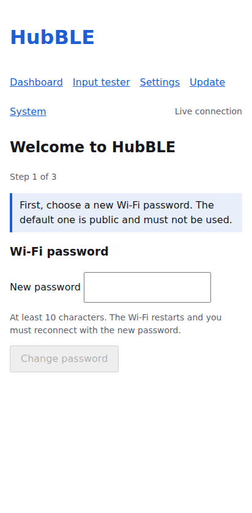

Choose a Wi-Fi password of at least 10 characters. The Wi-Fi restarts, so the phone has to rejoin with the new password.
Step 2 shows a **printable QR sticker**: the first code joins the Wi-Fi, the second opens the web app. Print it and stick
it on the dongle (the password is only in the code, not written anywhere else).

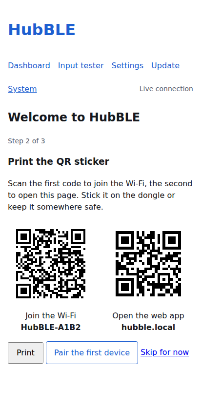

## Opening the page

Joining the dongle's Wi-Fi offers to open the page by itself (the "sign in to the network" pop-up), which is the only
reliable way on Android. You can also open `http://192.168.4.1` (or `http://hubble.local`) in the browser, or scan the second
QR code of the sticker.

**Android:** the dongle has no internet, so Android keeps its browser on mobile data and a browser opened by hand cannot
reach `192.168.4.1` (Chrome shows `ERR_TOO_MANY_RETRIES` or a timeout). Use the "Sign in to Wi-Fi" notification, or turn mobile
data off while you configure the dongle, or choose "Stay connected" when Android asks about the network.

In Settings, *Open this page when joining the Wi-Fi* can be turned off: nothing pops up then, which suits iPhones and PCs
but makes the Android problem above permanent.

## Turning the Wi-Fi on without a keyboard

The Wi-Fi is off during normal use. Any of these switches it on, so you are never locked out when the keyboard is off or
its battery is flat: hold **Ctrl and Alt** for 3 seconds on a paired keyboard; hold the **left and right mouse buttons**
together for 3 seconds on a paired mouse or trackball; or press the small **BOOT** button on the dongle once. The same three
gestures confirm a pairing or an update when *Require physical confirmation* is on. Replugging the dongle also gives you the
boot window (5 minutes by default).

## 2. Devices

The app has four tabs along the bottom: **Devices**, **Update**, **Settings** and **System**. The Devices tab shows one card per paired device (tap it for the details): type, connection state, battery, signal, the **security badge** (see below) and the measured
latency the dongle adds. The top shows the firmware version, the USB state seen by the computer and when the Wi-Fi switches off.
**Switch Wi-Fi off now** turns the dongle's Wi-Fi off at once (useful to test the devices without the radio
competing with Bluetooth). It stays off until you hold **Ctrl and Alt together for 3 seconds** on a paired keyboard, or
replug the dongle. It is refused while no device is paired, because the Wi-Fi is then the only way to pair one.

A device whose battery is at or below 20 % shows a **Low battery** badge and a warning at the top.
The **Test input** button opens the input tester and **Add device** starts a pairing.

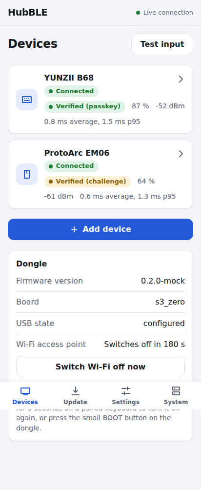

| Badge | Meaning |
|---|---|
| 🟢 Verified (passkey) | Keyboard paired with a passkey typed on it: protected against a man in the middle. |
| 🟡 Verified (challenge) | Just Works device checked by a challenge: you know *which* device it is, but a radio attacker during the pairing window is not excluded. |
| 🔴 Legacy pairing | Old pairing without LE Secure Connections, allowed by you for one device. Can be eavesdropped. |

## 3. Adding a device

**Add device**, put the keyboard or mouse in pairing mode, **Scan for devices**, pick it. Pairing lasts at most 60 seconds
and one device at a time.

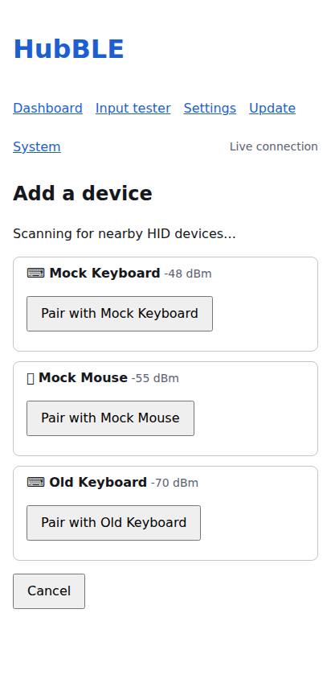

**Keyboards** show a 6-digit passkey: type it on the keyboard and press Enter.

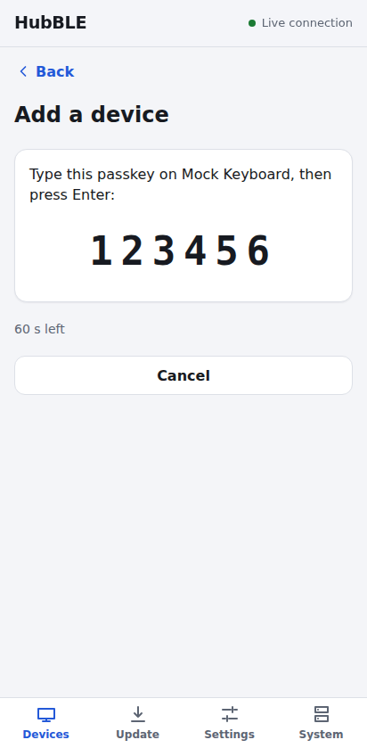

**Mice, trackballs and keyboards that only do Just Works** go into *quarantine*: they are connected but muted (nothing
reaches the computer). Press the buttons in the order shown (or type the code) within 30 seconds. Progress is live. A wrong
answer or a timeout removes the device again.

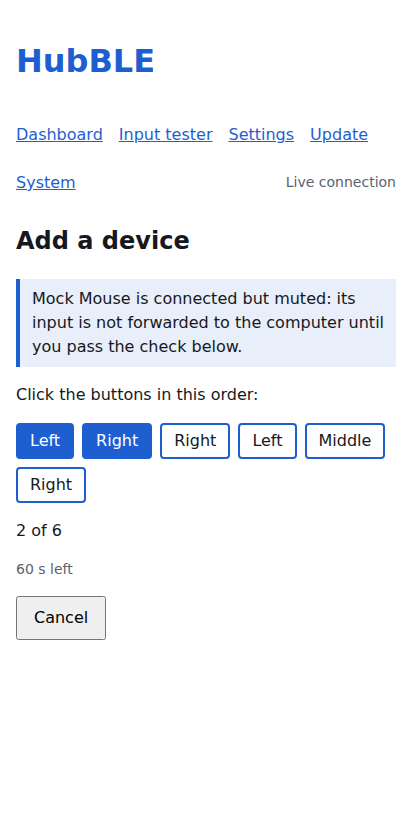

If *Require physical confirmation* is on and a keyboard is already paired, finish by holding **Ctrl and Alt for 3
seconds** on that keyboard. Three failed pairings in a row lock pairing for 60 seconds. Details and limits:
[Pairing and security](pairing-and-security.md).

## 4. Device details

Rename or forget a device, see the negotiated connection interval, signal, battery, reconnects and latency statistics
(minimum, average, 95th percentile, maximum), and a battery chart of the current session. **Export report map** downloads
the device's HID report map as hex (useful for bug reports; the device must be connected).

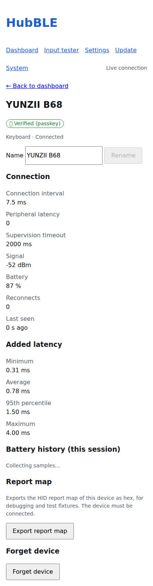

## 5. Input tester

Open it from **Test input** on the Devices tab. Press **Start** to see, live, what each device sends: keys with modifiers, mouse movement, wheel and buttons. It only runs
while the page is open and enabled; nothing is stored. Quarantined devices are not shown.

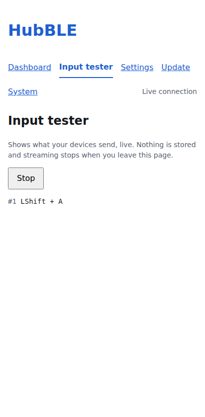

## 6. Settings

Physical confirmation, how long the Wi-Fi stays on (after power-up and after the last client), remote wakeup, LED
brightness and indication, the Ctrl + Alt gesture time, the update channel, and the Wi-Fi network used for updates. The network
password is write-only: the dongle never shows it again. Language (English or Italian) is here too.

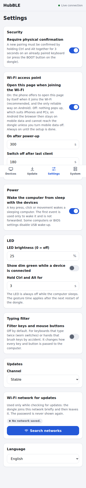

To choose the **Wi-Fi network for updates**, tap **Search networks**: the dongle lists the networks around it (strongest
first, with a padlock for protected ones), you tap yours and type the password. Use **Other network…** only for a hidden
network. While it searches, this connection may stall for a second or two.

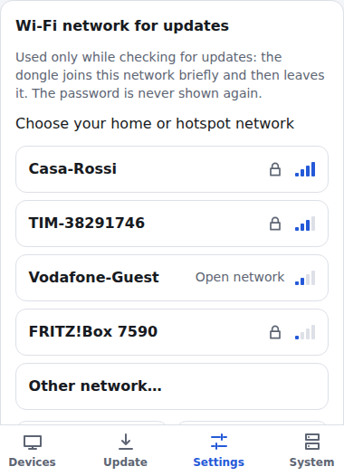

## 7. Updates

**Check for updates** joins your saved Wi-Fi network briefly, finds the newest release of the chosen channel (*Stable* or
*Pre-release*) and shows its version, size, signature state and release notes. **Install** downloads it, verifies the SHA-256
and the signature and restarts. HID forwarding keeps working during the download. If physical confirmation is on, hold both
Ctrl + Alt for 3 seconds when asked. An older version needs an explicit confirmation. Or install a `*-ota.bin` file you
downloaded. If the new firmware does not pass its self-test it is rolled back automatically. See
[OTA and recovery](ota-and-recovery.md).

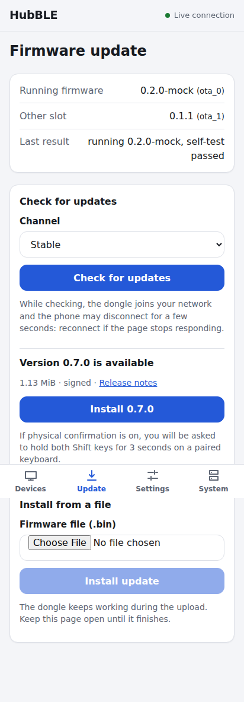

## 8. System

Uptime, last reset reason, free memory, power state, Bluetooth and Wi-Fi status, live log with download, **backup and
restore** of the settings (paired devices are never exported, they contain keys), reboot, **reboot to USB download mode**
(re-flash without touching BOOT) and **factory reset** (erases everything, including all pairings).

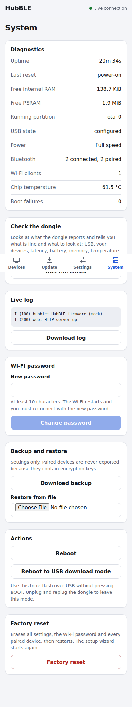

## 9. How the dongle behaves

- The Wi-Fi is **off** during normal use. It turns on at power-up for a few minutes, while no device is paired, and when you
  hold **Ctrl and Alt together for 3 seconds** on a paired keyboard.
- While at least one phone has the web app open, the Wi-Fi stays on; after the last one leaves it switches off after the
  idle time.
- When the computer **sleeps**, the dongle asks your devices to save battery, turns the Wi-Fi and LED off, and (if allowed)
  lets a key press wake the computer. See [Power](power.md).
- **Forgot the Wi-Fi password?** Hold Ctrl + Alt + Esc for 10 seconds on a paired keyboard. See
  [Troubleshooting](troubleshooting.md).

## 10. LED

Off when a device is connected. Slow amber pulse: no device. Blue breathing: Wi-Fi on. Cyan blink: pairing. Magenta blink:
quarantine challenge. Purple blink: update. Three red blinks at start: a rollback happened. The LED is always off while the
computer sleeps; brightness is configurable (0 turns it off).

## Help improve compatibility

On a device's page, **Prepare a report** builds a compatibility report (the device's report map, identifiers and the
connection values). You see exactly what it contains before anything is shared. It never includes what you type, the
Bluetooth address, the name you gave the device or any Wi-Fi data. You can download it, and when the project's collection
service is configured you can send it from the page. See [Compatibility](compatibility.md).

## Typing filter (off by default)

For a keyboard that types twice (worn switches) or hands that brush keys by accident, **Settings → Typing filter** can clean
up the keys and mouse buttons before they reach the computer. It is **off** until you turn it on, and it applies at once.

- **Ignore a repeated press within N ms:** a key or button pressed again that soon after it was released is ignored (it stops
  double letters and double clicks). 30 to 80 ms is typical.
- **A press counts after being held for N ms:** a brief touch is dropped. It delays every key by that long, so keep it small.
  Zero turns each part off.

## Check the dongle

**System → Run the check** looks at what the dongle reports and lists what is fine and what to look at: whether the
computer sees it, each device (connected, battery, added latency, connection interval), memory, temperature and the reason of
the last restart. **Copy the result** puts the list on the clipboard, ready to paste into a message or an issue.

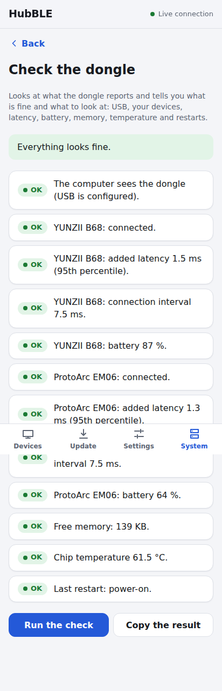
